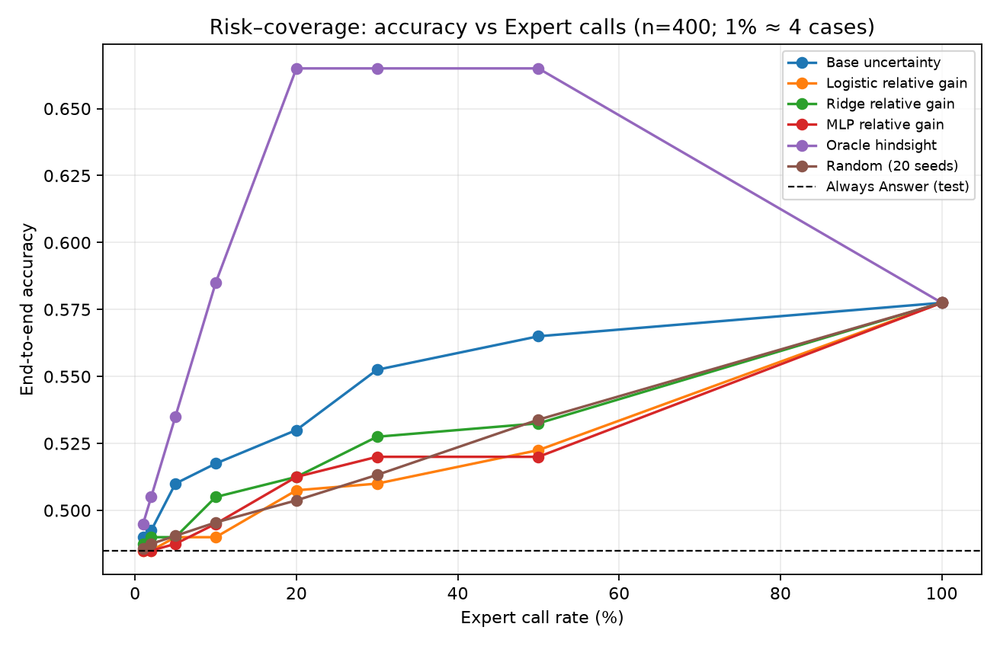
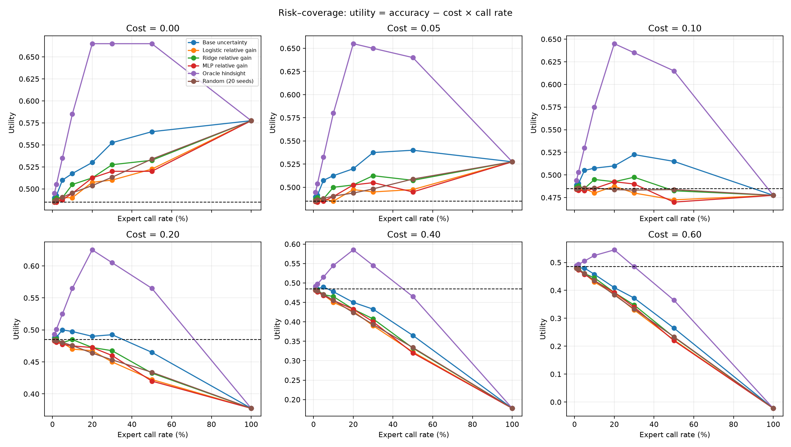
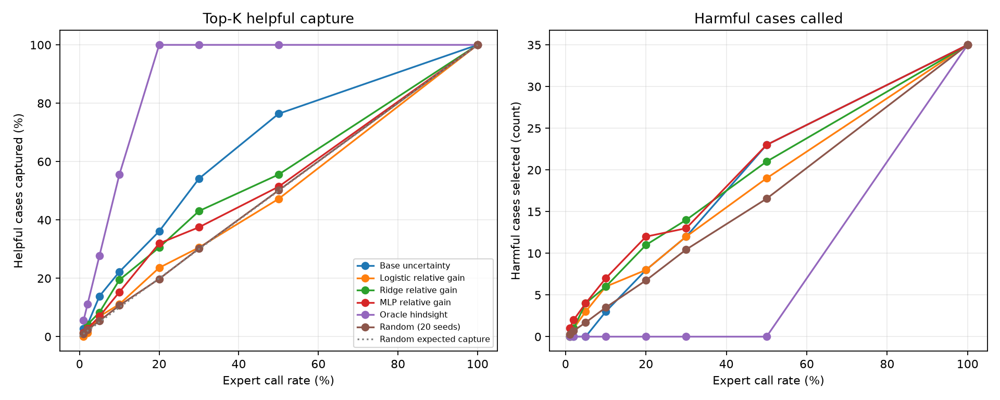

# Expert 相对收益可预测性与 Router 修复报告

本报告对应 Attempt04 冻结的 1,700 例配对队列，分析输出独立保存于本目录。没有重跑 Base/Expert 推理，没有使用 GPU，也没有启动 PPO、GRPO 或 ATPO。

## 1. 实验设置和数据审计

- 模型：Base `Qwen/Qwen3-8B`；Expert `Qwen/Qwen3-32B-AWQ`。
- 固定 split：train 1000、validation 300、test 400。Test 是从 ATPO train split 抽取的 400 例 holdout，不是官方独立 test split。
- 病例级检查：每个 split 内 `case_id`、`case_hash`、`prompt_hash` 唯一；训练、验证、测试互不重叠； paired rows 与两路 trajectory 的身份、预测、correct 标签逐条一致。完整计数见 `integrity_audit.json`。
- 同一 Gold：原推理脚本在 `build_case` 中为每例构造一次 Gold，并在 Base 与 Expert 两次 `predicted == case['gold']` 比较中复用；配对文件也逐条匹配两路轨迹。Gold 没有进入特征或新产物。
- 重复采样：三 split 共 1,700 个唯一 case/prompt hash，没有发现重复病例被当作独立记录。
- Test 配对结果：Base 0.485 (194/400); Expert 0.5775 (231/400); paired gain +0.0925（+9.25 pp），bootstrap 95% CI [+0.043, +0.145]。helpful 72 例，harmful 35 例。
- Expert parser failures：train/validation/test 分别 38/13/15，共 66；这些记录全部按错误计分。Base parser failures 分别 3/0/0。
- 正确性、Utility 与 AUROC 的定义见配置。Bootstrap 使用 test 病例配对重采样 10,000 次；AUC 区间使用 2,000 次。成本按 `accuracy - cost × DEFER_rate` 一次扣除。
- 泄漏状态：训练/预处理只使用 train；模型和每个成本阈值仅由 train/validation 决定；policy lock 在读取 test 前写出。旧报告已对同一 test holdout 做过一次冻结后评估，因此本次是重复使用的 holdout 复核，不能宣称为独立新泛化验证。没有发现旧报告按 test 调阈值的记录，但重复查看结果带来研究者自由度风险。
- 执行记录：Attempt02 在 policy lock 后读取并转换 test 特征，随后因 train/validation bootstrap 索引长度 bug 在计算 split summary 前中止；Attempt03 使用相同确定性 train/validation fit 与阈值完成 test 指标，报告组装失败后由 `--finalize-existing` 读取已保存结果组装本文。修复期间没有用 test 结果改特征、模型或阈值；完整日志保留在 `logs/`。
- 提交版本：原始 run manifest 记录 `e047b66183ccacaa84e513f70fd91e23562103cf`；本地仓库 HEAD 与用户给出的 `2aedfa8` 不同（本次审计环境中 `2aedfa8` 不存在，HEAD 为 `2aebfa8`）。原始数据和报告均未覆盖。

## 2. 特征审计与修复

旧 `public_features()` 对选项行使用行首正则，未匹配时把 `option_count`、`mean_option_chars` 写成数值 0。源 prompt 重建审计确认，所有三 split 的旧与扩展选项行模式都没有匹配；这不能证明临床题目本身没有选项，所以本轮将两列标为 unavailable，而不是“真实 0”。模型特征纳入/排除只按 train 定：这两列在 train 全部不可用，故从各模型统一特征集排除；validation/test 的检查仅作为字段审计。Prompt 字符/词数、问号、数字和词典计数在 1,700 例上均与冻结 prompt 重算完全一致。

Base uncertainty 定义为对 A/B/C/D 归一化概率的 Shannon entropy 除以 `ln(4)`；confidence 是最大选项概率；margin 是 top-1 减 top-2 概率。有效行的概率和、重算熵和 margin 均通过检查：1697 条有效，熵不匹配 0，margin 不匹配 0。缺失通过 mask 保留，不填成 0；插补与标准化仅在 train 拟合。

Base prompt token 数、Base completion token 数以及回答 A-D 的置信度/概率、解析有效标志均在可选 Expert 调用前可见。没有使用 Gold、Expert 文本/正确率、Oracle 或事后结果。各 split 的缺失率、唯一值数、均值、标准差和可用性见 [`feature_audit.csv`](feature_audit.csv)。

| Feature | Train missing / unique | Validation missing / unique | Test missing / unique | Used |
|---|---:|---:|---:|---:|
| log_public_chars | 0.000 / 312.0 | 0.000 / 177.0 | 0.000 / 215.0 | yes |
| log_public_words | 0.000 / 75.0 | 0.000 / 55.0 | 0.000 / 70.0 | yes |
| option_count | 1.000 / 0.0 | 1.000 / 0.0 | 1.000 / 0.0 | no |
| mean_option_chars | 1.000 / 0.0 | 1.000 / 0.0 | 1.000 / 0.0 | no |
| base_confidence | 0.003 / 992.0 | 0.000 / 300.0 | 0.000 / 399.0 | yes |
| base_entropy_normalized | 0.003 / 996.0 | 0.000 / 300.0 | 0.000 / 400.0 | yes |
| base_top1_top2_margin | 0.003 / 986.0 | 0.000 / 298.0 | 0.000 / 397.0 | yes |
| base_uncertainty_missing | 0.000 / 2.0 | 0.000 / 1.0 | 0.000 / 1.0 | yes |
| base_valid | 0.000 / 2.0 | 0.000 / 1.0 | 0.000 / 1.0 | yes |
| log_base_prompt_tokens | 0.000 / 97.0 | 0.000 / 69.0 | 0.000 / 81.0 | yes |
| log_base_completion_tokens | 0.000 / 4.0 | 0.000 / 1.0 | 0.000 / 1.0 | yes |

## 3. 可预测性比较

标签严格区分 `base_error`、`expert_helpful`、`expert_harmful` 与三值 `relative_gain = expert_correct - base_correct`。下面是 test AUROC（95% bootstrap CI）和 relative gain Spearman；Base Error AUROC 不再替代 Helpful/Relative Gain 指标。

| Score/model | Base Error AUROC | Helpful AUROC | Harmful AUROC | Relative-gain Spearman |
|---|---:|---:|---:|---:|
| Base Uncertainty | 0.686 [0.633, 0.737] | 0.710 [0.645, 0.771] | 0.614 [0.539, 0.688] | 0.161 |
| Logistic Base Error | 0.626 [0.570, 0.682] | 0.597 [0.522, 0.668] | 0.542 [0.437, 0.640] | 0.080 |
| Logistic Relative Gain | — | 0.583 [0.505, 0.660] | 0.468 [0.366, 0.571] | -0.052 |
| Ridge Relative Gain | — | 0.574 [0.499, 0.648] | 0.420 [0.313, 0.523] | 0.037 |
| MLP Relative Gain | — | 0.613 [0.532, 0.689] | 0.480 [0.380, 0.588] | -0.018 |

完整 train/validation/test 目标指标见 [`predictive_targets.csv`](predictive_targets.csv)。用于决策的 Ridge 直接回归 relative gain；Logistic Relative Gain 是独立拟合 helpful/harmful 两个 logistic 概率后取 `P(helpful)-P(harmful)`；MLP 是三类 `(-1, 0, 1)` softmax。

## 4. 成本敏感性

阈值只在 validation 上按相同 Utility 规则逐成本选择；test 只应用冻结阈值。表中为 test Utility，含 Always Answer/DEFER、匹配调用预算的 Random、学习路由、不确定性路由以及仅作理论上界的 Oracle。

| Router | 0.00 | 0.05 | 0.10 | 0.20 | 0.40 | 0.60 |
|---|---:|---:|---:|---:|---:|---:|
| Always Answer | 0.485 | 0.485 | 0.485 | 0.485 | 0.485 | 0.485 |
| Always DEFER | 0.578 | 0.527 | 0.478 | 0.378 | 0.177 | -0.022 |
| Base Uncertainty | 0.575 | 0.529 | 0.505 | 0.498 | 0.485 | 0.485 |
| Logistic Base Error | 0.573 | 0.525 | 0.514 | 0.485 | 0.484 | 0.484 |
| Logistic Relative Gain | 0.557 | 0.514 | 0.482 | 0.485 | 0.485 | 0.485 |
| Ridge Relative Gain | 0.570 | 0.526 | 0.483 | 0.485 | 0.485 | 0.485 |
| MLP Relative Gain | 0.578 | 0.530 | 0.486 | 0.485 | 0.485 | 0.485 |
| Oracle Selective DEFER (hindsight upper bound) | 0.665 | 0.656 | 0.647 | 0.629 | 0.593 | 0.557 |
| Random matched to Base Uncertainty | 0.568 | 0.517 | 0.483 | 0.482 | 0.485 | 0.485 |
| Random matched to Logistic Base Error | 0.573 | 0.525 | 0.486 | 0.485 | 0.485 | 0.485 |
| Random matched to Logistic Relative Gain | 0.565 | 0.521 | 0.484 | 0.485 | 0.485 | 0.485 |
| Random matched to Ridge Relative Gain | 0.567 | 0.522 | 0.478 | 0.485 | 0.485 | 0.485 |
| Random matched to MLP Relative Gain | 0.573 | 0.525 | 0.486 | 0.484 | 0.482 | 0.485 |

原主成本 0.60 的详细指标：

| Router | Accuracy | Utility | DEFER rate | Expert calls | Utility lift vs Base (paired 95% CI) | Utility diff vs uncertainty (paired 95% CI) | Helpful capture | Base-correct regression |
|---|---:|---:|---:|---:|---:|---:|---:|---:|
| Always Answer | 0.485 | 0.485 | 0.000 | 0.0 | +0.000 [+0.000, +0.000] | +0.000 [+0.000, +0.000] | 0.000 | 0.000 |
| Always DEFER | 0.578 | -0.022 | 1.000 | 400.0 | -0.507 [-0.557, -0.455] | -0.507 [-0.557, -0.455] | 1.000 | 0.180 |
| Base Uncertainty | 0.485 | 0.485 | 0.000 | 0.0 | +0.000 [+0.000, +0.000] | +0.000 [+0.000, +0.000] | 0.000 | 0.000 |
| Logistic Base Error | 0.485 | 0.484 | 0.003 | 1.0 | -0.002 [-0.004, +0.000] | -0.002 [-0.004, +0.000] | 0.000 | 0.000 |
| Logistic Relative Gain | 0.485 | 0.485 | 0.000 | 0.0 | +0.000 [+0.000, +0.000] | +0.000 [+0.000, +0.000] | 0.000 | 0.000 |
| Ridge Relative Gain | 0.485 | 0.485 | 0.000 | 0.0 | +0.000 [+0.000, +0.000] | +0.000 [+0.000, +0.000] | 0.000 | 0.000 |
| MLP Relative Gain | 0.485 | 0.485 | 0.000 | 0.0 | +0.000 [+0.000, +0.000] | +0.000 [+0.000, +0.000] | 0.000 | 0.000 |
| Oracle Selective DEFER (hindsight upper bound) | 0.665 | 0.557 | 0.180 | 72.0 | +0.072 [+0.057, +0.087] | +0.072 [+0.057, +0.087] | 1.000 | 0.000 |

`cost_sensitivity.csv` 含每个 Router × 成本的 Accuracy、Utility、DEFER rate、平均成本、调用数、相对 Always Answer 的配对 95% CI、与 uncertainty 的配对差值、Expert correction capture 与 Base-correct regression。Random 以 20 个固定 seed 匹配每个 Router 的 validation 调用率；Utility/Accuracy 是 20 seed 均值，其 paired 95% CI 按病例重采样，另报告 20 个 seed 单次结果的 2.5–97.5 百分位区间。成本 0 的 Oracle 按 `relative_gain > 0` 调用；其他成本按净收益条件 `relative_gain > cost`，没有把所有 helpful 都无条件调用。

其中 correction capture = 被调用且 Expert 修复 Base 错误的病例 / 全部 helpful 病例；Base-correct regression = 被调用且 Expert 把 Base 正确变错的病例 / 全部 Base 正确病例。

## 5. 风险—覆盖率与收益排序

每个有预测分数的 Router 按 test 预测收益降序评估 `[1%, 2%, 5%, 10%, 20%, 30%, 50%, 100%]` 调用率。`risk_coverage.csv` 报告 helpful 捕获、harmful 调用、净正确变化以及相同调用数下相对随机期望的差异；这些曲线是冻结模型的 test 诊断，不用于改阈值。

Test 只有 400 例，1% 调用约 4 例，2% 约 8 例；这些小覆盖点的计数和曲线不稳定，不能据此推断部署表现。

## 6. 失败归因

详见 [`failure_attribution.md`](failure_attribution.md)。核心判断基于新输出：

1. 旧 Logistic 的特征问题部分得到证实：两项选项特征是解析 fallback 零值且被旧模型纳入；普通 prompt 词面特征则复现正确。移除不可用选项列后，新 Logistic Relative Gain test Helpful AUROC 为 0.583、Harmful 为 0.468，net Spearman 为 -0.052；因此特征修复没有单独解决净收益排序。
2. MLP Helpful/Harmful AUROC 从 train 0.675/0.688、validation 0.581/0.583 到 test 0.613/0.480；relative-gain Spearman 分别 +0.148/-0.018/-0.018。这支持对 harmful 区分有泛化衰减/过拟合风险，但不足以单凭 400 例区分样本不足与抽样噪声。
3. Base uncertainty 对 Base Error 与 Expert Helpful/Harmful 的能力分别报告。旧结果中的 AUROC 0.710 对应 helpful 标签，而不是 Base Error；旧 0.573/约 0.504 也不能被称作净相对收益 AUROC，旧分析把 `base_error_corrected` 和 `positive_relative_advantage` 映射成同一个 helpful 标签。
4. 若成本 0.60 下 validation 阈值为 0% DEFER，这是验证集估计的增量正确率不足以跨过预设成本的决策；Oracle 的 hindsight 结果不能证明可预测策略可达到。
5. 可部署收益以配对 Utility lift CI 与相对收益排序能力判断，不按 Accuracy 单独判定。

## 7. 局限性

- 同一 holdout 已在旧报告中查看，且只有 400 例；新结果不是独立复验。尤其低调用率处每个病例会明显改变估计。
- 这些是固定 Base/Expert、固定 parser 和一次性调用条件下的离线配对结果，不是临床效果或真实用户效用证据。
- Expert 格式失败被端到端计为错误，与实际严格 parser 的部署结果一致；若以后改 parser，必须另行预注册复验，不能事后修补本次标签。
- 输入特征主要是 prompt 词面、Base 概率与 Base 输出长度；没有检验新患者信息、检索、专家解释或跨模型族外部泛化。
- 本次阈值与模型选择复用同一 validation；小样本下阈值估计仍有选择噪声。

## 8. RL 决策

**B. 暂不进入 RL；优先改进监督 Router、校准与决策前特征，并在新病例 holdout 上复验。**

结论编码：**B**。在独立病例上稳定复现监督路由的相对收益和目标成本下的 Utility 前，不应把当前结果当作启动 RL 的充分证据。
