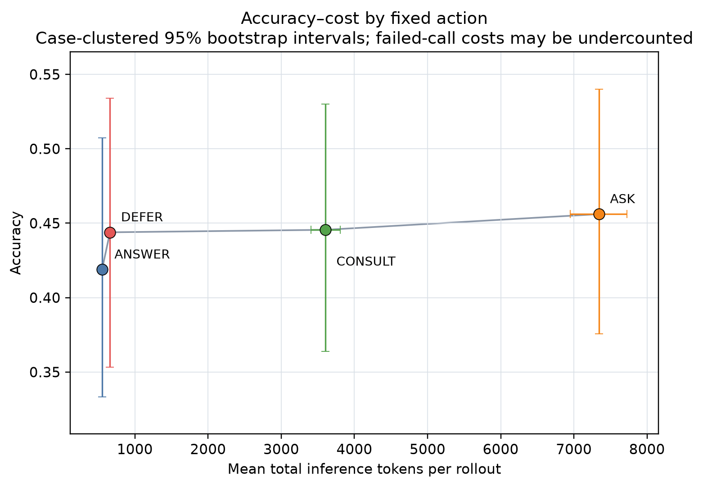
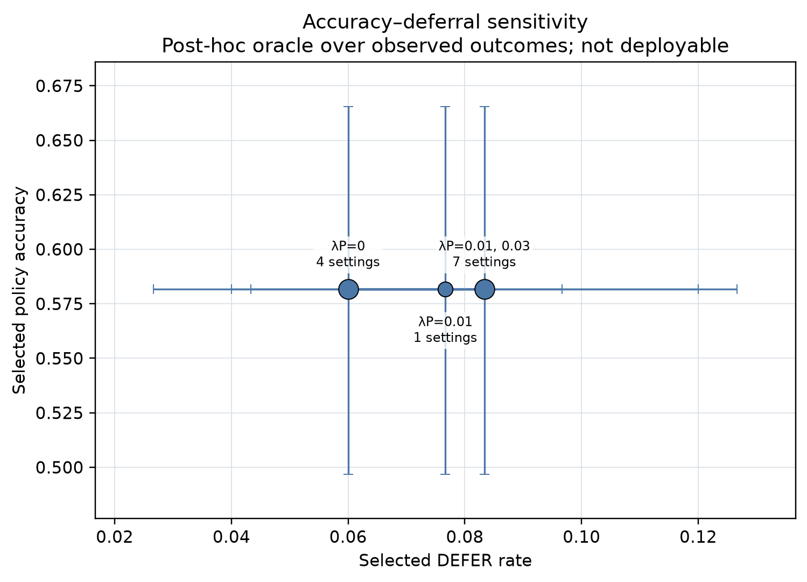

# EA-ATPO 真实数据 Pilot 报告

状态：**completed**。本实验为真实 Qwen 模型推理，不是 Router/ATPO 训练。

## 实验规模

- 数据：[https://github.com/Quark-Medical/ATPO](https://github.com/Quark-Medical/ATPO) 官方快照 `25af83688c06917f94245a4db06be7d0924c090c` 的训练集，14,256 例；固定种子 `20261103` 抽取 100 例。抽样源行号保存在 `run_manifest.json`。
- 状态与分支：3 个公开状态上限/病例，实际 291 个状态；四动作各 3 次，完整轨迹 3,492 条。
- 完成情况：有效 3,465/3,492（99.2%）；协议失败 27 条。
- 模型：`Qwen/Qwen3-8B` revision `b968826d9c46dd6066d109eabc6255188de91218`；vLLM `0.33.0`，GPU 1，BF16，`TRITON_ATTN`。
- Base、Patient、Expert 均为同一个 Qwen3-8B 的模拟角色；没有真实医生参与。Patient 只接收 `atomic_facts`，Base/Expert 只看公开状态，Expert 请求前执行隐藏事实与特权字段检查。Gold 仅在分支结束后用于评分。
- 动作语法由 vLLM regex structured output 约束；模型仍生成具体问题、咨询焦点和选项。最后一个 Base turn 要求输出终局答案。每条 rollout 最多一次 CONSULT。

## 四动作结果

| 初始动作 | 准确率（95% 病例 bootstrap CI） | 协议有效率 | 总 token / rollout | 专家 token / rollout | 患者轮数 / rollout | 延迟（秒） |
|---|---:|---:|---:|---:|---:|---:|
| ANSWER | 41.9% [33.3, 50.7]% | 100.0% | 551 | 0 | 0.00 | 0.067 |
| ASK | 45.6% [37.6, 54.0]% | 99.4% | 7,344 | 493 | 5.92 | 1.550 |
| CONSULT | 44.6% [36.4, 53.0]% | 99.1% | 3,604 | 814 | 1.52 | 0.812 |
| DEFER | 44.4% [35.3, 53.4]% | 98.4% | 660 | 660 | 0.00 | 0.077 |

准确率按病例汇总公开状态和重复 rollout；无效轨迹在准确率中保守记为 0。延迟为本地 vLLM 测得的秒数。失败 Expert 调用在响应格式校验阶段未保存 usage，因此失败样本的 token/延迟均值可能偏低。

## CONSULT 的独立价值

- CONSULT − ANSWER 配对准确率差：+2.67 个百分点，95% CI `[-1.8, 7.2]%`。区间包含 0，当前 Pilot 未能确认 CONSULT 有独立准确率增益。
- CONSULT − DEFER 配对准确率差：+0.17 个百分点，95% CI `[-4.7, 5.0]%`。
- 按状态×重复次数配对：ANSWER 错误的 508 组中，CONSULT 修正 78 组（15.4%）；ANSWER 正确的 365 组中，CONSULT 退化 56 组（15.3%）。修正与退化频率接近。
- 每次 CONSULT 平均使用约 814 个 Expert token、3,604 个总 token、0.81 秒；这是本地推理成本，不是美元价格。

## 四动作可区分性与成本敏感性

无成本时，经验最优动作占比（291 个公开状态）：

| ANSWER | ASK | CONSULT | DEFER |
|---:|---:|---:|---:|
| 77.7% | 10.7% | 6.2% | 5.5% |

四动作都在部分状态上成为经验最优。全成本网格中各动作的最优占比范围：

| ANSWER | ASK | CONSULT | DEFER |
|---:|---:|---:|---:|
| 77.7%–77.7% | 6.9%–10.7% | 6.2%–7.6% | 5.5%–7.9% |

成本网格为 `lambdaE ∈ {0, 0.02, 0.05, 0.1}`（每千 Expert token 的效用惩罚）与 `lambdaP ∈ {0, 0.01, 0.03}`（每患者轮次惩罚），均为敏感性单位。基于四动作实测结果逐状态选出的 post-hoc oracle 在网格中准确率均为 58.2%，DEFER 率 6.0%–8.3%，总 token 1,265–1,501/rollout。该 oracle 使用了事后 gold outcome，不能作为可部署 Router 的性能结论。

数值点和区间可在 `action_cost_accuracy_points.csv` 与 `tradeoff_curve_points.csv` 中复核；矢量版为同名 `.svg`。

## 失败与边界

- 27 条失败均保留在原始 JSONL 和汇总错误分析中；失败轨迹的 outcome 记为 0。其初始动作分布：ASK 5、CONSULT 8、DEFER 14、ANSWER 0。主要原因是模拟 Expert 输出不符合 CONSULT/DEFER 格式或触发终局答案泄漏规则，不是推理服务或数据下载中断。
- 本 Pilot 用 ATPO 训练 split 的公开医学选择题，不是真实临床记录或患者试验；模拟 Patient/Expert 都不是医生。结果只支持工程可行性和描述性比较。
- CONSULT − ANSWER 的置信区间跨 0，因此现有证据不足以宣称 CONSULT 提升准确率。100 例 Pilot 也不用于训练或评估最终策略泛化。

## 复现与文件

- Base/Patient/Expert smoke：`../service_role_smoke.jsonl`；10 例 smoke：`../smoke/`（120/120 有效）。首轮失败轨迹另存于 `../smoke_attempt1/`。
- 完整轨迹：`pilot_trajectories.jsonl`；公开状态：`pilot_public_states.jsonl`；统计：`summary.csv`、`action_value_analysis.csv`；配置/哈希：`run_manifest.json`。
- 数据源与模型文件清单：`../assets/source_manifest.json`、`../assets/adapter_manifest.json`、`../assets/models/model_manifest.json`。原始 ATPO JSONL 未覆盖；未启动 Router 或 ATPO RL 训练。
- 报告构建输入：`summary.csv`；抽样病例数：100，首尾源行索引 `1465` / `3534`。
- 结果图由 Matplotlib `3.11.2` 绘制；依赖锁：`/pfs/pfs-spMCeu/image_team/workspace/zjr/EA_ATPO/experiments/real_case_pilot_20261103/PILOT_ANALYSIS_REQUIREMENTS.lock.txt`。
